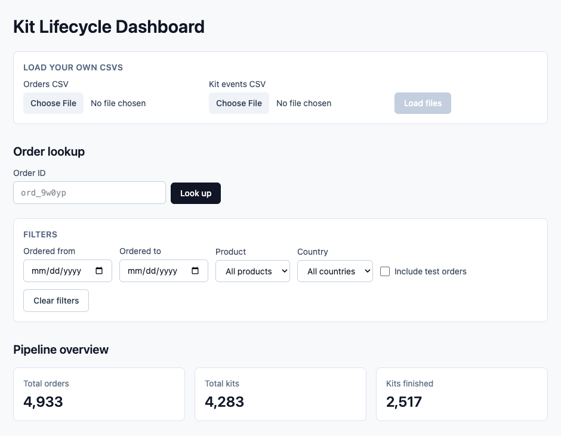

# nebula

**Live app:** https://danusontarangkul.github.io/nebula/

## Contributors

- [David Anusontarangkul](https://github.com/danusontarangkul)

## Decisions and assumptions about the data

- Convert all timestamps to UTC
- Timestamps without UTC is treated as UTC
- Remove duplicate events
- Exculde unreadable time stamps
- Remove orphan events
- Remove rows with empty kit_id or order_id because they can't be used
- Listing paid orders with no events as stuck

## What I'd do next with more time

- User can go back to the default (pre loaded data). Right now, the user will have to da a refresh.
- Add data visualization tool
- Currently have only exact lookup, the query will do a filter as user types with debounce.

## How I used AI

- AI Tools used: Claude Code
- Used AI to generate test csv
- AI was used to brainstorm and write plan as in REQUIREMENTS.md. I wanted to make sure the requirements were as clear as possible where exact user stories and acceptance crieteria so AI doesn't give wrong answers and make assumptions that are too off.
- I use CLAUDE.md files to help generate rules. When I see bad code quality, I add it to the rule.

### AI Failed

AI mostly failed at code quality when it is being generated. Here are some notes as I coded.

- Generated too much requirements, have to narrow
- Add extra code when it wasn't being used yet
- New branch needed to be created for each requirement
- 1 component per react file
